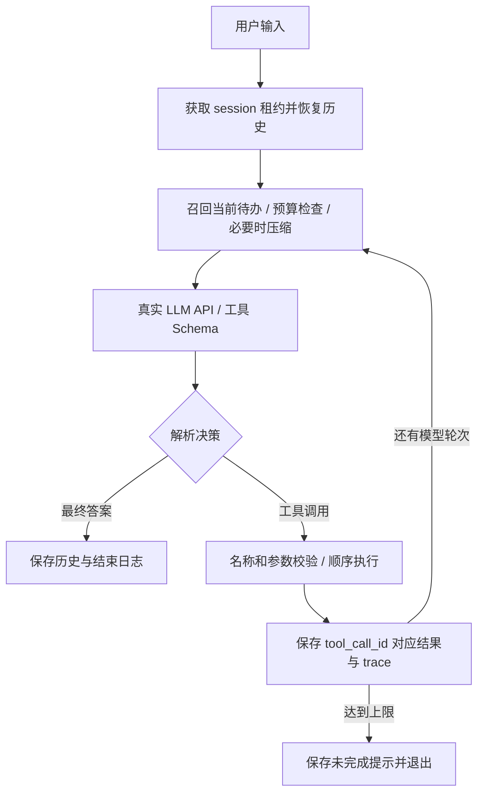

# Minimal Agent Harness

从零实现的 Python Agent Runtime，核心流程不依赖 LangGraph、OpenHands、OpenClaw 或其他 Agent 框架。使用真实的 OpenAI-compatible Chat Completions API，由模型根据工具 Schema 自主选择回复或调用工具。

## 快速运行

需要 Python 3.11+。以下命令在项目根目录执行。

```powershell
python -m venv .venv
.venv/Scripts/python -m pip install -e .
Copy-Item .env.example .env
```

编辑 `.env`，填写自己的 API 凭证：

```dotenv
LLM_BASE_URL=https://api.openai.com/v1
LLM_MODEL=gpt-6.1-sol
LLM_API_KEY=
AGENT_DB=.agent/state.db
```

`LLM_API_KEY` 必须填写。模型及端点需要当前账号有权限；若使用网关，填写网关真实提供的 HTTPS Base URL 和精确模型 ID。Base URL 包含 `/v1` 等版本路径，但不包含 `/chat/completions`。环境变量优先于 `.env`。不提供 API 代理服务，不在仓库提交密钥。

```powershell
# 终端/窗口 1
.venv/Scripts/python -m agent_harness --user A --session weather
# 终端/窗口 2
.venv/Scripts/python -m agent_harness --user A --session report
```

窗口 1 输入“查厦门天气并记一个带伞的待办”，然后追问“把刚才的待办完成”。窗口 2 输入“帮我组织周报，并记一个周五交周报的待办”。使用相同 user/session 重新打开可继续聊天，两个窗口的历史、摘要和待办互不共享。`/exit` 退出。

```powershell
python -m agent_harness --user A --session weather --message "用计算器算 (125+75)*3"
python -m agent_harness --user A --session weather --todos
python -m agent_harness --user A --session weather --trace
```

## 工具与循环

| 工具 | 行为 | 边界 |
| --- | --- | --- |
| calculator | 四则运算、整除、取余、有限幂运算 | AST 白名单，无 `eval`；限制长度、节点数、指数和数值范围 |
| search | 检索本地三条固定资料 | 明确为 mock；无匹配返回空数组，不伪造网页结果 |
| todo | 添加、列出、完成、删除 | 必需工具；按 user/session 隔离，最多 50 项 |
| weather | 四座城市的固定天气 | 演示用 mock，回答必须说明并非真实预报 |

`Registry.register(name, description, schema, handler)` 注册工具。仅使用 `jsonschema` 做参数验证，它不是 Agent 框架。Schema 通过 `tools` 发给模型；不使用关键字匹配来决定调用哪个工具。模型输出解析器提取可见行动说明、`tool_calls` 或最终答案；私有 `reasoning_content` 不存储、不召回，也不作为工具执行依据。简短行动说明不是隐藏思维链。



每个用户回合最多 8 次模型决策，每次最多 4 个工具调用；摘要调用单独发生，不执行工具。同一批工具依模型顺序执行，避免待办读写依赖被并发打乱。每个工具调用对应一个 `role=tool` 消息，包括失败结果，随后交回模型决定是否修正。达到上限时不声称任务完成。

## Session、状态与中断

SQLite WAL 存放三类数据：`sessions` 存摘要和消息历史，`todos` 存结构化任务，`events` 存 trace。所有查询按 `(user_id, session_id)` 限定。CLI 的 `--user` 是本地命名空间，不是身份认证；若改成服务，必须由已认证身份绑定 user，不能信任请求自报身份。

同一 session 用原子条件更新获得 300 秒租约；每次模型/工具执行前更新，模型调用后再次确认，保存历史时检查 owner。单次 HTTP 超时 40 秒，仅针对部分 HTTP 状态重试一次，内置工具都是有界本地执行。不同 session 的模型请求不共享锁，SQLite 写事务短暂串行。同一 session busy 时立即拒绝新请求，用户可稍后重试，本实现没有后台队列。

工具执行前保存调用意图，执行后保存结果。若进程在二者之间崩溃，下次恢复会为未闭合调用添加 `Interrupted` 结果，明确“副作用可能发生，应先检查状态”，不会自动重放写操作。这个最小实现没有工具副作用与结果消息的原子提交，不承诺 exactly-once；真实支付等操作需外部幂等键和事务 outbox。

## Context 与 memory

每次模型决策前组装：系统行为约束 → 历史资料（摘要＋当前 session 待办）→ 最近完整消息。历史资料以标明数据性质的 user 消息放置，而不是动态拼成更高优先级的系统命令。工具返回也视为数据。这减少指令层级混淆，但不是对 prompt injection 的形式化防护。

| 信息 | 召回时机 | 放置与用途 |
| --- | --- | --- |
| 最近用户输入和 assistant 答案 | 每次模型调用 | 原始消息，支撑纯对话追问 |
| 工具调用与结果 | 当前及保留的最近对话 | 完整 assistant/tool 块，保留 call ID，支撑工具追问 |
| 当前待办 | 每次模型调用前从数据库重新查询 | 历史资料中的 `current_session_todos`，以数据库现状为准 |
| 早期对话摘要 | 超出预算后写回，下轮自动召回 | 保留目标、实体、偏好、结果、未完成事项和不确定性 |
| trace、隐藏思维链 | 不召回 | trace 仅排错，隐藏思维链不保存 |

待办数量很小，直接按 scope 查询，比引入向量库简单可靠。本实现没有跨 session 的全局用户画像，也没有把每句聊天写成长期记忆。

默认输入预算为 60,000 个 UTF-8 序列化字节，包含系统提示、历史、memory 与工具 Schema。对常见 byte-based tokenizer 这是保守估算，不是适配所有供应商的精确 token 计数；选用模型需预留至少该输入预算和 2,048 输出 token。

超过预算，优先保留最近两个用户回合，将更早的完整回合总结；仍超限可继续压缩上一回合。绝不裁断 assistant/tool 配对，也不删除当前回合来假装任务仍完整。当前回合仍放不下时明确拒绝并要求拆分任务。摘要输入和输出均有界；摘要失败保留带“可能丢失”标记的有限原文片段。摘要是有损的，不能保证任意旧事实永不遗忘；下一步扩展应保留可检索原始事件并在低置信时回查。

## 异常和可观察性

- 工具不存在、JSON 损坏、参数类型/字段错误和计算错误返回 `ok=false`，模型可据此调整。
- 处理网络超时、HTTP 认证/配额失败、无效 JSON、截断输出、空答案、重复调用 ID、超大输入/输出；错误消息不打印密钥或供应商原始响应体。
- HTTP 429/500/502/503/504 最多重试一次；工具写入不自动重试。拒绝 HTTP 重定向以避免转发 Authorization。
- trace 包含 turn ID、call ID、工具名、结果、成功状态、耗时、压缩和结束原因。默认不写请求头；工具结果可能含用户数据，应保护本地数据库。

## 验证

```powershell
# 离线确定性测试：不消耗 API 额度
python -m unittest discover -s tests -v
# 真实 LLM 验收：需要 .env，会发生真实 API 费用
python scripts/live_smoke.py
```

离线测试用脚本化模型返回测试循环和状态，不能证明某个真实模型会正确选择工具。真实验收脚本检查天气工具与模拟声明、待办副作用、工具追问、计算、窗口隔离和普通追问；报告保存在忽略提交的 `.agent/live-smoke.json`。失败会返回非零退出码并记录失败类型，不得把跳过或失败写成通过。

详细测试状态见 [验证记录](docs/VALIDATION.md)。GitHub Actions 在 Python 3.11/3.12/3.13 上运行离线测试，不配置真实 API 密钥。

## 提交材料

- [五个模块的架构设计回答](docs/ARCHITECTURE.md)：每个模块各选一道。
- [AI Prompt 与问题解决记录](docs/AI_RECORD.md)：真实协作过程、决策和修复。
- [验证记录及待完成条件](docs/VALIDATION.md)。

## 取舍

这是一份 CLI 最小实现，不增加 Web 服务、向量数据库、定时调度、异步工具执行或多 Agent 编排。架构题里的 actor/mailbox、检索和异步事件是扩展设计，不宣称已经在代码中实现。

参考：[OpenAI function calling](https://developers.openai.com/api/docs/guides/function-calling)、[GPT-6.1 Sol 模型说明](https://developers.openai.com/api/docs/models/gpt-6.1-sol)。
